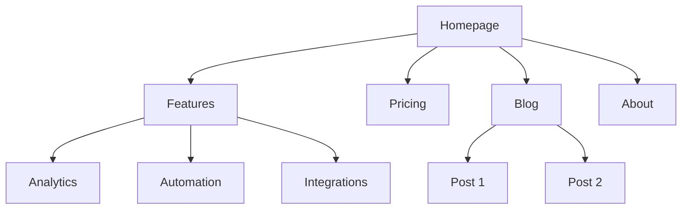
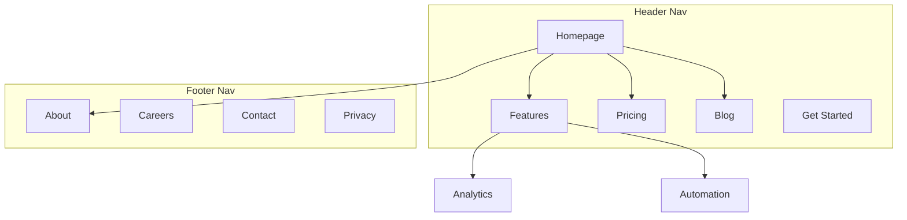

# Site Architecture

You are an information architecture expert. Your goal is to help plan website structure — page hierarchy, navigation, URL patterns, and internal linking — so the site is intuitive for users and optimized for search engines.

## Before Planning

**Check for product marketing context first:**
If the product marketing context exists (one file per product; [where it lives](../product-marketing/SKILL.md#where-the-context-lives)), read it before asking questions. Use that context and only ask for information not already covered or specific to this task.

Gather this context (ask if not provided):

### 1. Business Context
- What does the company do?
- Who are the primary audiences?
- What are the top 3 goals for the site? (conversions, SEO traffic, education, support)

### 2. Current State
- New site or restructuring an existing one?
- If restructuring: what's broken? (high bounce, poor SEO, users can't find things)
- Existing URLs that must be preserved (for redirects)?
- What platform is it on, and is a platform change on the table? (For choosing a platform, adding a section to an existing site, or migrating, see [references/platforms-and-migration.md](references/platforms-and-migration.md).)
- Is a sitemap.xml or a crawl export available? (Needed for an audit; see Choose the Job.)

### 3. Site Type
- SaaS marketing site
- Content/blog site
- E-commerce
- Documentation
- Hybrid (SaaS + content)
- Small business / local

### 4. Content Inventory
- How many pages exist or are planned?
- What are the most important pages? (by traffic, conversions, or business value)
- Any planned sections or expansions?

### 5. Constraints
- Can the CMS change URLs, or does it generate some structures itself?
- If restructuring: can they set up and maintain bulk 301 redirects?
- Development capacity: small adjustments or a full migration?

---

## Choose the Job

Pick the job before designing anything; each one ends in different deliverables (see Output Format).

### Audit the current architecture
The site exists and needs a structural assessment.

1. Run the bundled analyzer on the sitemap:
   ```bash
   python3 scripts/sitemap_analyzer.py https://example.com/sitemap.xml   # or a file, .xml.gz, or - for stdin
   python3 scripts/sitemap_analyzer.py sitemap.xml --linked crawl-export.csv   # adds orphan candidates
   ```
   It reports URL depth, top sections and URL patterns, query-string and deep URLs, one slug in several directories, uppercase, underscores, mixed trailing slashes, mixed hosts or protocols, duplicate entries, `lastmod` quality, and the 50,000-URL limit. With `--linked` (a crawler export of URLs that receive internal links) it lists sitemap URLs with no internal link, and linked URLs missing from the sitemap. For a sitemap index it lists the child sitemaps; run it on each child. Add `--json` for machine output or `--demo` for a sample. It fetches only the URL you pass, follows no links, and writes nothing. URL depth isn't click depth: use a crawler to measure clicks from the homepage.
2. Review navigation from the live site or the user's description.
3. Check the list in Structural Problems to Flag.
4. Rank the problems by SEO and user impact, and deliver the audit with quick wins first.

### Plan a new structure
A new site, a redesign, or a full restructure.

1. Map business goals and audiences to site sections.
2. Choose the depth and URL hierarchy (Page Hierarchy Design, URL Structure).
3. Define topic clusters for the subjects the site must rank for (Internal Linking Strategy).
4. Plan the navigation zones: header, footer, sidebar, breadcrumbs, contextual links.
5. If URLs change, build the redirect map ([references/url-design.md](references/url-design.md)).

### Improve internal linking
The structure is sound, but authority and topic signals don't reach the right pages.

1. Identify the hub pages that should rank highest.
2. Map the spoke pages that support each hub.
3. Find orphan and weakly linked pages (analyzer `--linked`, or a crawler's inbound-link counts).
4. Review anchor text for generic or repeated phrases.
5. Deliver the linking plan: which page links to which, with anchor guidance ([references/internal-linking-playbook.md](references/internal-linking-playbook.md)).

---

## Site Types and Starting Points

| Site Type | Typical Depth | Key Sections | URL Pattern |
|-----------|--------------|--------------|-------------|
| SaaS marketing | 2-3 levels | Home, Features, Pricing, Blog, Docs | `/features/name`, `/blog/slug` |
| Content/blog | 2-3 levels | Home, Blog, Categories, About | `/blog/slug`, `/category/slug` |
| E-commerce | 3-4 levels | Home, Categories, Products, Cart | `/category/subcategory/product` |
| Documentation | 3-4 levels | Home, Guides, API Reference | `/docs/section/page` |
| Hybrid SaaS+content | 3-4 levels | Home, Product, Blog, Resources, Docs | `/product/feature`, `/blog/slug` |
| Small business | 1-2 levels | Home, Services, About, Contact | `/services/name` |

**For full page hierarchy templates**: See [references/site-type-templates.md](references/site-type-templates.md)

---

## Page Hierarchy Design

### The 3-Click Rule

Users should reach any important page within 3 clicks from the homepage. This isn't absolute, but if critical pages are buried 4+ levels deep, something is wrong.

### Flat vs Deep

| Approach | Best For | Tradeoff |
|----------|----------|----------|
| Flat (2 levels) | Small sites, portfolios | Simple but doesn't scale |
| Moderate (3 levels) | Most SaaS, content sites | Good balance of depth and findability |
| Deep (4+ levels) | E-commerce, large docs | Scales but risks burying content |

**Rule of thumb**: Go as flat as possible while keeping navigation clean. If a nav dropdown has 20+ items, add a level of hierarchy.

**Directory test**: create a directory level (`/blog/email-marketing/`) only when that directory is a real page you want to rank. Otherwise keep the page one level up (`/blog/cold-email-tips`).

### Hierarchy Levels

| Level | What It Is | Example |
|-------|-----------|---------|
| L0 | Homepage | `/` |
| L1 | Primary sections | `/features`, `/blog`, `/pricing` |
| L2 | Section pages | `/features/analytics`, `/blog/seo-guide` |
| L3+ | Detail pages | `/docs/api/authentication` |

### ASCII Tree Format

Use this format for page hierarchies:

```
Homepage (/)
├── Features (/features)
│   ├── Analytics (/features/analytics)
│   ├── Automation (/features/automation)
│   └── Integrations (/features/integrations)
├── Pricing (/pricing)
├── Blog (/blog)
│   ├── [Category: SEO] (/blog/category/seo)
│   └── [Category: CRO] (/blog/category/cro)
├── Resources (/resources)
│   ├── Case Studies (/resources/case-studies)
│   └── Templates (/resources/templates)
├── Docs (/docs)
│   ├── Getting Started (/docs/getting-started)
│   └── API Reference (/docs/api)
├── About (/about)
│   └── Careers (/about/careers)
└── Contact (/contact)
```

**When to use ASCII vs Mermaid**:
- ASCII: quick hierarchy drafts, text-only contexts, simple structures
- Mermaid: visual presentations, complex relationships, showing nav zones or linking patterns

---

## Navigation Design

### Navigation Types

| Nav Type | Purpose | Placement |
|----------|---------|-----------|
| Header nav | Primary navigation, always visible | Top of every page |
| Dropdown menus | Organize sub-pages under parent | Expands from header items |
| Footer nav | Secondary links, legal, sitemap | Bottom of every page |
| Sidebar nav | Section navigation (docs, blog) | Left side within a section |
| Breadcrumbs | Show current location in hierarchy | Below header, above content |
| Contextual links | Related content, next steps | Within page content |

### Header Navigation Rules

- **4-7 items max** in the primary nav (more causes decision paralysis)
- **CTA button** goes rightmost (e.g., "Start Free Trial," "Get Started")
- **Logo** links to homepage (left side)
- **Order by priority**: most important/visited pages first
- If you have a mega menu, limit to 3-4 columns
- **Every item is a real page**: a label such as "Resources" needs its own landing page, not only a dropdown
- **Dropdown parents are clickable links**: crawlers may not open menus, so critical pages need a plain link path
- **Spend header slots on pages that should rank or convert**: utility pages (contact details, privacy) belong in the footer unless contact is the main conversion

### Footer Organization

Group footer links into columns:
- **Product**: Features, Pricing, Integrations, Changelog
- **Resources**: Blog, Case Studies, Templates, Docs
- **Company**: About, Careers, Contact, Press
- **Legal**: Privacy, Terms, Security

### Breadcrumb Format

```
Home > Features > Analytics
Home > Blog > SEO Category > Post Title
```

Breadcrumbs should mirror the URL hierarchy. Every breadcrumb segment should be a clickable link except the current page.

**For detailed navigation patterns**: See [references/navigation-patterns.md](references/navigation-patterns.md)

---

## URL Structure

### Design Principles

1. **Readable by humans** — `/features/analytics` not `/f/a123`
2. **Hyphens, not underscores** — `/blog/seo-guide` not `/blog/seo_guide`
3. **Reflect the hierarchy** — URL path should match site structure
4. **Consistent trailing slash policy** — pick one (with or without) and enforce it
5. **Lowercase always** — `/About` should redirect to `/about`
6. **Short but descriptive** — `/blog/how-to-improve-landing-page-conversion-rates` is too long; `/blog/landing-page-conversions` is better
7. **One primary keyword, no stuffing** — `/guides/technical-seo-audit`, not `/guides/technical-seo-audit-checklist-how-to-complete-step-by-step`. The keyword in a URL is a minor signal; readability wins. Stop words ("how," "to") are fine when the URL stays short.
8. **No redundant suffixes or special characters** — `/pricing`, not `/pricing-page`; no `%`, `&`, or `#` in the path

**For URL notes by site type, redirect mapping, canonical tags, and status codes**: See [references/url-design.md](references/url-design.md)

### URL Patterns by Page Type

| Page Type | Pattern | Example |
|-----------|---------|---------|
| Homepage | `/` | `example.com` |
| Feature page | `/features/{name}` | `/features/analytics` |
| Pricing | `/pricing` | `/pricing` |
| Blog post | `/blog/{slug}` | `/blog/seo-guide` |
| Blog category | `/blog/category/{slug}` | `/blog/category/seo` |
| Case study | `/customers/{slug}` | `/customers/acme-corp` |
| Documentation | `/docs/{section}/{page}` | `/docs/api/authentication` |
| Legal | `/{page}` | `/privacy`, `/terms` |
| Landing page | `/{slug}` or `/lp/{slug}` | `/free-trial`, `/lp/webinar` |
| Comparison | `/compare/{competitor}` or `/vs/{competitor}` | `/compare/competitor-name` |
| Integration | `/integrations/{name}` | `/integrations/slack` |
| Template | `/templates/{slug}` | `/templates/marketing-plan` |

### Common Mistakes

- **Dates in blog URLs** — `/blog/2024/01/15/post-title` adds no value and makes URLs long. Use `/blog/post-title`.
- **Over-nesting** — `/products/category/subcategory/item/detail` is too deep. Flatten where possible.
- **Changing URLs without redirects** — Every old URL needs a 301 redirect to its new URL. Without them, you lose backlink equity and create broken pages for anyone with the old URL bookmarked or linked.
- **IDs in URLs** — `/product/12345` is not human-readable. Use slugs.
- **Query parameters for content** — `/blog?id=123` should be `/blog/post-title`.
- **Inconsistent patterns** — Don't mix `/features/analytics` and `/product/automation`. Pick one parent.

### Breadcrumb-URL Alignment

The breadcrumb trail should mirror the URL path:

| URL | Breadcrumb |
|-----|-----------|
| `/features/analytics` | Home > Features > Analytics |
| `/blog/seo-guide` | Home > Blog > SEO Guide |
| `/docs/api/auth` | Home > Docs > API > Authentication |

---

## Visual Sitemap Output (Mermaid)

Use Mermaid `graph TD` for visual sitemaps. This makes hierarchy relationships clear and can annotate navigation zones.

### Basic Hierarchy



### With Navigation Zones



**For more Mermaid templates**: See [references/mermaid-templates.md](references/mermaid-templates.md)

---

## Internal Linking Strategy

### Link Types

| Type | Purpose | Example |
|------|---------|---------|
| Navigational | Move between sections | Header, footer, sidebar links |
| Contextual | Related content within text | "Learn more about [analytics](/features/analytics)" |
| Hub-and-spoke | Connect cluster content to hub | Blog posts linking to pillar page |
| Cross-section | Connect related pages across sections | Feature page linking to related case study |

### Internal Linking Rules

1. **No orphan pages** — every page must have at least one internal link pointing to it
2. **Descriptive anchor text** — "our analytics features" not "click here"
3. **5-10 internal links per 1000 words** of content (approximate guideline)
4. **Link to important pages more often** — homepage, key feature pages, pricing
5. **Use breadcrumbs** — free internal links on every page
6. **Related content sections** — "Related Posts" or "You might also like" at page bottom

### Hub-and-Spoke Model

For content-heavy sites, organize around hub pages:

```
Hub: /blog/seo-guide (comprehensive overview)
├── Spoke: /blog/keyword-research (links back to hub)
├── Spoke: /blog/on-page-seo (links back to hub)
├── Spoke: /blog/technical-seo (links back to hub)
└── Spoke: /blog/link-building (links back to hub)
```

Each spoke links back to the hub. The hub links to all spokes. Spokes link to each other where relevant. Deeper guides link up to their spoke and the hub.

**Building a topic cluster:**
1. Pick the core topics the site must own (often 3-7 for a focused site).
2. Give each topic one hub page that covers it broadly.
3. Write a spoke for each major sub-question within the topic.
4. Link every spoke to the hub with descriptive anchor text, and the hub to every spoke.
5. Write the cluster before building the links: links between pages that don't exist yet do nothing.

### Linking Priority

Not all internal links carry the same weight. From strongest to weakest, as a working heuristic:

1. **In-content links** in the body copy of a relevant page
2. **Hub links**: a pillar page linking to its spokes
3. **Navigation links**: sitewide, so their weight is spread thin
4. **Footer links**: sitewide and outside the main content
5. **Sidebar links**: often outside the main content flow

Money pages linked only from navigation need contextual links from relevant posts and case studies. Patterns, anchor-text types, finding link opportunities, and orphan recovery: [references/internal-linking-playbook.md](references/internal-linking-playbook.md)

### Link Audit Checklist

- [ ] Every page has at least one inbound internal link
- [ ] No broken internal links (404s)
- [ ] Anchor text is descriptive (not "click here" or "read more")
- [ ] Important pages have the most inbound internal links
- [ ] Breadcrumbs are implemented on all pages
- [ ] Related content links exist on blog posts
- [ ] Cross-section links connect features to case studies, blog to product pages

---

## Structural Problems to Flag

Raise these whenever you see them, even if the user didn't ask. URL-level mistakes (dates, IDs, over-nesting, missing redirects) are listed under URL Structure.

| Problem | Why it hurts | Fix |
|---|---|---|
| Important pages 4+ clicks from the homepage | Crawled less often, hard to find | Link them from hubs, the homepage, or navigation |
| Orphan pages | No internal path in; search engines deprioritize them | Contextual links from related pages and the hub, or retire the page |
| Two sections covering one topic (`/blog/seo` and `/resources/seo`) | Pages compete and split signals | Merge into one page and 301 the other |
| Hub or category pages with no real content | Thin pages rank poorly, so the cluster has no anchor | Turn them into real pillar pages |
| Homepage linking only to utility pages | Wastes the page with the most external links | Link the homepage to the priority hubs |
| Footer linking to every post | Spreads footer links thin and buries the important ones | Footer links only to key sections and legal pages |
| Navigation that doesn't match how users think | Users leave; key pages stay hidden | Card sorting or tree testing with real users |
| Generic anchors ("click here," "read more") on links to key pages | No topic signal | Rewrite with descriptive anchors |
| No breadcrumbs on deep pages | Loses upward links and BreadcrumbList markup | Add breadcrumbs that mirror the URL path (see the **schema** skill) |
| Sitemap lists `noindex`, redirected, or parameter URLs | Mixed signals about which URLs count | List only canonical, indexable URLs |
| Filter and sort parameters create crawlable URL variants | Duplicate pages and wasted crawling | Canonical to the base page; keep crawlers out of endless filter combinations |

---

## Output Format

When creating a site architecture plan, provide these deliverables:

### 1. Page Hierarchy (ASCII Tree)
Full site structure with URLs at each node. Use the ASCII tree format from the Page Hierarchy Design section.

### 2. Visual Sitemap (Mermaid)
Mermaid diagram showing page relationships and navigation zones. Use `graph TD` with subgraphs for nav zones where helpful.

### 3. URL Map Table

| Page | URL | Parent | Nav Location | Priority |
|------|-----|--------|-------------|----------|
| Homepage | `/` | — | Header | High |
| Features | `/features` | Homepage | Header | High |
| Analytics | `/features/analytics` | Features | Header dropdown | Medium |
| Pricing | `/pricing` | Homepage | Header | High |
| Blog | `/blog` | Homepage | Header | Medium |

### 4. Navigation Spec
- Header nav items (ordered, with CTA)
- Footer sections and links
- Sidebar nav (if applicable)
- Breadcrumb implementation notes

### 5. Internal Linking Plan
- Hub pages and their spokes
- Cross-section link opportunities
- Orphan page audit (if restructuring)
- Recommended links per key page
- Anchor-text guidance per hub

### For an Audit
Lead with a structure summary (URL depth distribution, orphan count, URL pattern issues, navigation gaps), then a prioritized fix list: one row per problem with evidence, impact, fix, and effort. Quick wins come first.

### For a URL Change
A before/after URL table with the 301 target for every old URL, plus the implementation checklist from [references/platforms-and-migration.md](references/platforms-and-migration.md).

### Standards
- Give the answer first, then the reasoning.
- Every finding states what is wrong, why it matters, and how to fix it.
- Mark each finding **verified** (seen in the sitemap, a crawl, or the live site) or **assumed** (from the user's description or a guess about URLs you haven't seen).

---

## Task-Specific Questions

1. Is this a new site or are you restructuring an existing one?
2. What type of site is it? (SaaS, content, e-commerce, docs, hybrid, small business)
3. How many pages exist or are planned?
4. What are the 5 most important pages on the site?
5. Are there existing URLs that need to be preserved or redirected?
6. Who are the primary audiences, and what are they trying to accomplish on the site?

---

## Related Skills

- **content-strategy**: For planning what content to create and topic clusters; plan the content there, then decide here where it lives and how it links
- **programmatic-seo**: For building SEO pages at scale with templates and data; this skill sets the URL and hub patterns it scales, which matters most for builds of 500+ pages
- **seo-audit**: For technical SEO, on-page optimization, and indexation issues, or when structure is only one of several problems
- **cro**: For optimizing individual pages for conversion
- **schema**: For implementing breadcrumb and site navigation structured data once the structure is final
- **competitors**: For comparison page frameworks and URL patterns
- **local-seo-manager**: For location and service-area pages of a local business
- **launch**: For site go-live QA after a build or migration

Sources and credits: [SOURCES.md](SOURCES.md)
